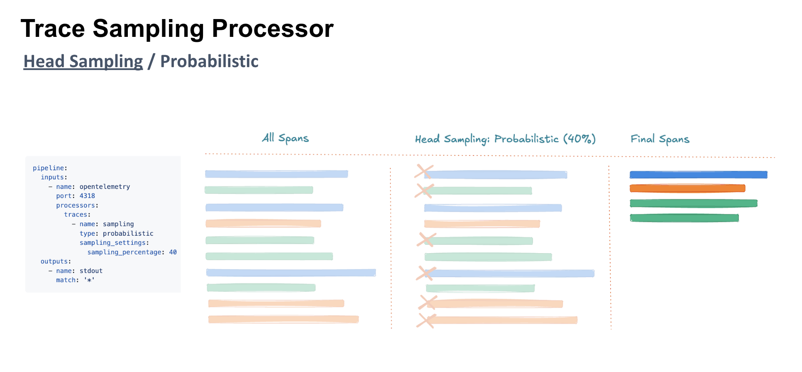
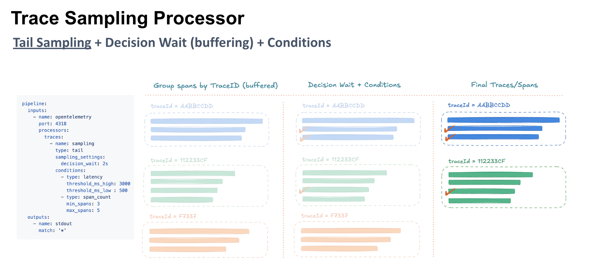

# Sampling

The _sampling_ processor reduces exported telemetry volume. Probabilistic sampling supports logs, metrics, and traces on input and output pipelines. Tail sampling supports traces on input pipelines only. Sampling doesn't reduce application instrumentation or Fluent Bit ingestion cost.



Only [YAML configuration files](../../administration/configuring-fluent-bit/yaml.md) support processors.



## Configuration parameters

This processor uses the following configuration parameters:

| Key | Description | Default |
| --- | ----------- | ------- |
| `conditions` | An array of objects where each object specifies a different [condition](#conditions) for `tail` sampling. The possible items in each object vary by `conditions.type`. Startup fails if `conditions` is set when the processor's top-level `type` is `probabilistic`. | _none_ |
| `debug` | Enables debug mode, which prints the trace and its spans. | `false` |
| `sampling_settings` | Contains key/value pairs for different sampling settings. These settings vary by `type`. | _none_ |
| `type` | The type of sampling to perform. Possible values: `probabilistic` ([head sampling](#head-sampling)) or `tail` ([tail sampling](#tail-sampling)). | _none_ |

## Head sampling

Probabilistic trace sampling makes a keep/drop decision from the complete 16-byte trace ID without waiting for the trace to finish. Spans with the same trace ID receive the same decision at the same sampling percentage, across requests and processor instances.



Head sampling uses the following `sampling_settings` configuration parameters:

| Key | Description |
| --- | :---------- |
| `sampling_percentage` | Percentage to retain, from `0` to `100`, including fractions such as `12.5`. Defaults to `10`. Zero drops all eligible data; 100 keeps all eligible data. |
| `sampling_key` | Literal log field name used for stable decisions. Defaults to `trace_id`. An explicitly set value must be non-empty. Ignored for metrics and traces. |

This example uses head sampling to process a smaller percentage of the overall ingested traces and spans. It accomplishes this by setting up the pipeline to ingest on the OpenTelemetry defined port using the OpenTelemetry Protocol (OTLP). The `processor` section defines traces for head sampling and the percentage of traces and spans to forward to the specified output plugins.




```yaml
service:
  flush: 1
  log_level: info
  hot_reload: on

pipeline:
  inputs:
    - name: opentelemetry
      port: 4318

      processors:
        traces:
          # Head sampling of traces (percentage)
          - name: sampling
            type: probabilistic
            sampling_settings:
              sampling_percentage: 40

  outputs:
    - name: stdout
      match: "*"
```




This configuration retains approximately 40% of distinct valid trace IDs. A percentage is an expected fraction across diverse IDs, not a quota for each batch. Missing, incorrectly sized, and all-zero trace IDs are dropped.

The full-trace-ID hash changes the selected cohort compared with earlier implementations that used only the first eight bytes. Upgrade instances that must agree on sampling decisions together. The sampler doesn't implement OpenTelemetry consistent probability sampling or read or write W3C sampling probability metadata.

## Log sampling

Configure probabilistic log sampling under `processors.logs`. The processor looks for the field named by the `sampling_key` setting in OTLP record metadata, ordinary record metadata, then the log body. The configured name is matched as a literal field name; it's not a record accessor. String and byte values are supported.

With the default `trace_id` key, 16-byte binary IDs and 32-character hexadecimal IDs normalize to the same value as trace spans. Configure the same percentage for logs and traces to retain correlated telemetry together. Logs with absent, malformed, or zero trace IDs receive independent probabilistic decisions rather than being dropped automatically.

For ordinary application logs, use a field such as `request_id`. Equal keys receive equal decisions. If the key is absent, empty, or has an unsupported type, each log receives an independent decision that's not stable across restarts or replays.

The following pipeline samples correlated logs and traces at 12.5%:




```yaml
service:
  flush: 1

pipeline:
  inputs:
    - name: opentelemetry
      port: 4318
      processors:
        logs:
          - name: sampling
            type: probabilistic
            sampling_settings:
              sampling_percentage: 12.5
        traces:
          - name: sampling
            type: probabilistic
            sampling_settings:
              sampling_percentage: 12.5
  outputs:
    - name: stdout
      match: '*'
      format: otlp_json
```




### Select Kubernetes namespaces or applications

Use the generic processor `condition` (singular) to select which logs are eligible for sampling. Logs that don't match pass through unchanged, including logs missing fields required by an equality rule. This is separate from the tail sampler's `conditions` array.

The following example receives logs whose bodies already contain Kubernetes enrichment. It samples 10% of logs from the `checkout` application in the `staging` namespace and preserves all other logs. The accessors read the `kubernetes` map in the log body; OTLP resource attributes have a different layout and aren't selected by these accessors.




```yaml
service:
  flush: 1

pipeline:
  inputs:
    - name: forward
      listen: 0.0.0.0
      port: 24224
  outputs:
    - name: stdout
      match: '*'
      processors:
        logs:
          - name: sampling
            type: probabilistic
            condition:
              op: and
              rules:
                - field: "$kubernetes['namespace_name']"
                  op: eq
                  value: staging
                - field: "$kubernetes['labels']['app']"
                  op: eq
                  value: checkout
            sampling_settings:
              sampling_percentage: 10
```




Kubernetes enrichment must run before sampling. In a pipeline using the Kubernetes filter, put the sampler on the output as shown so it can see fields added by the filter. Set the label rule to the label key used by your workloads. Remove one rule to select only a namespace or application.

To assign different rates, use separate samplers with disjoint conditions. A log matching multiple samplers is evaluated by each matching processor. When the processors use the same `sampling_key` and the log has a usable key, each processor compares the same key hash against its own percentage threshold. Identical percentages produce the same decision, and different percentages retain the log only if it falls under the lowest threshold. Logs without a usable key receive an independent random decision from each processor. Keep a trace ID or request ID as the sampling key: using a namespace or application name as the key makes that entire namespace or application share one keep/drop decision. Selectively sampling logs can change their retention relative to traces sampled separately.

The generic log `condition` doesn't provide namespace-specific probabilistic trace policies. Tail `string_attribute` conditions can match resource attributes such as `k8s.namespace.name` or `service.name`, but retain matching traces and drop unmatched traces. They don't apply a percentage to selected namespaces while preserving other traces.

## Metric sampling

Metric sampling selects complete series using the fully qualified metric name and exported label names and values. Label order, timestamps, point values, and batching don't change the decision. Labels added by preceding processors participate in the key. Resource and scope attributes are preserved but aren't part of the key, so equal series keys in different resources receive the same decision.

The following example selects approximately 25% of metric series:




```yaml
service:
  flush: 1

pipeline:
  inputs:
    - name: opentelemetry
      port: 4318
      processors:
        metrics:
          - name: sampling
            type: probabilistic
            sampling_settings:
              sampling_percentage: 25
  outputs:
    - name: stdout
      match: '*'
      format: otlp_json
```




Counters, gauges, untyped metrics, histograms, exponential histograms, and summaries are supported. Histogram buckets and summary quantiles stay together with their point. Selected series remain eligible across subsequent requests; values, aggregation temporality, and monotonicity are preserved.


Metric sampling selects series; it doesn't perform temporal downsampling or rescale values. Totals over selected series can be lower than actual totals. Don't sample metrics used for exact totals, alerts, and service level objective calculations.


## Tail sampling

Tail sampling offers a more selective and fine-grained control over the collection of traces and spans. It evaluates the entire trace when making a sampling decision and can inspect the metadata and status of traces to inform the decision.



Tail sampling uses the following `sampling_settings` configuration parameters:

| Key | Description | Default |
| --- | :---------- | ------- |
| `decision_wait` | Specifies how long to buffer spans before making a sampling decision, allowing full trace evaluation. Must be positive. | `30s` |
| `legacy_reconcile` | Uses the legacy tail-sampling reconciliation path instead of the optimized reconciler. Keep this disabled unless you need behavior parity while comparing results with older deployments. | `false` |
| `max_traces` | Positive maximum number of buffered traces. When the limit is reached, the oldest trace is deleted. This isn't a byte or span limit. | `50000` |

### Conditions

Tail sampling supports different conditions. Conditions use OR logic: a match on any span retains its buffered trace. Without `conditions`, buffered traces are retained. An explicitly empty `conditions` array matches nothing. The `conditions` array is supported only for tail sampling.

All spans belonging to one trace must reach the same processor instance. Late spans can start a new decision after an earlier decision expires. Pending traces are discarded during shutdown, and selected traces use the input's tag rather than dynamic per-request tags.

The following condition are available:

- [Latency](#latency)
- [Span count](#span-count)
- [Status code](#status-code)
- [String attribute](#string-attribute)
- [Numeric attribute](#numeric-attribute)
- [Boolean attribute](#boolean-attribute)
- [Trace state](#trace-state)

#### Latency

This condition samples traces based on span duration. It uses `threshold_ms_low` to capture short traces and `threshold_ms_high` for long traces.

The latency condition uses the following `conditions` configuration parameters:

| Key | Description | Default |
| --- | ----------- | ------- |
| `threshold_ms_high` | Specifies the upper latency threshold. Traces with a duration greater than or equal to this value will be sampled. | `0` |
| `threshold_ms_low` | Specifies the lower latency threshold. Traces with a duration less than or equal to this value will be sampled. | `0` |
| `type` | Sets the condition type. For the latency condition, this value must be `latency`. | _none_ |

The following example waits five seconds before making a decision. It then samples traces based on latency, capturing short traces of 200&nbsp;ms or less and long traces of 3000&nbsp;ms or more. Traces between 200&nbsp;ms and 3000&nbsp;ms won't be sampled unless another condition applies.




```yaml
service:
  flush: 1
  log_level: info
  hot_reload: on

pipeline:
  inputs:
    - name: opentelemetry
      port: 4318

      processors:
        traces:
          # Tail sampling of traces (latency)
          - name: sampling
            type: tail
            sampling_settings:
              decision_wait: 5s
            conditions:
              - type: latency
                threshold_ms_low: 200
                threshold_ms_high: 3000

  outputs:
    - name: stdout
      match: "*"
```




#### Span count

This condition samples traces that have specific span counts defined in a configurable range. It uses `min_spans` and `max_spans` to specify the number of spans a trace can have to be sampled.

The span count condition uses the following `conditions` configuration parameters:

| Key | Description | Default |
| --- | ----------- | ------- |
| `max_spans` | Specifies the maximum number of spans a trace can have to be sampled. | _none_ |
| `min_spans` | Specifies the minimum number of spans a trace must have to be sampled. | _none_ |
| `type` | Sets the condition type. For the span count condition, this value must be `span_count`. | _none_ |

The following example configuration waits five seconds before making a decision. It then samples traces with at least three spans but no more than five spans. Traces with less than three spans or greater than five spans won't be sampled unless another condition applies.




```yaml
service:
  flush: 1
  log_level: info
  hot_reload: on

pipeline:
  inputs:
    - name: opentelemetry
      port: 4318

      processors:
        traces:
          # Tail sampling of traces (span_count)
          - name: sampling
            type: tail
            sampling_settings:
              decision_wait: 5s
            conditions:
              - type: span_count
                min_spans: 3
                max_spans: 5

  outputs:
    - name: stdout
      match: "*"
```




#### Status code

This condition samples traces based on span status codes (`OK`, `ERROR`, `UNSET`).

The status code condition uses the following `conditions` configuration parameters:

| Key | Description | Default |
| --- | ----------- | ------- |
| `status_codes` | Defines an array of span status codes (`OK`, `ERROR`, `UNSET`) to filter traces. Traces are sampled if any span matches a listed status code. For example, `status_codes: [ERROR, UNSET]` captures traces with errors or unset statuses. | _none_ |
| `type` | Sets the condition type. For the status code condition, this value must be `status_code`. | _none_ |

The following example configuration samples only spans with the `ERROR` status code.




```yaml
service:
  flush: 1
  log_level: info
  hot_reload: on

pipeline:
  inputs:
    - name: opentelemetry
      port: 4318

      processors:
        traces:
          # Tail sampling of traces (status_code)
          - name: sampling
            type: tail
            sampling_settings:
              decision_wait: 5s
            conditions:
              - type: status_code
                status_codes: [ERROR]

  outputs:
    - name: stdout
      match: "*"
```




#### String attribute

This conditional lets you sample traces based on specific span or resource attributes. You can define key-value filters (for example, `http.method=POST`) to selectively capture relevant traces.

The string attribute condition uses the following `conditions` configuration parameters:

| Key | Description | Default |
| --- | ----------- | ------- |
| `key` | Specifies the span or resource attribute to match (for example, `"service.name"`). | _none_ |
| `match_type` | Defines how attributes are compared: `strict` ensures exact value matching (and is case-sensitive), `exists` checks if the attribute is present regardless of its value, and `regex` uses regular expression pattern matching. | `strict` |
| `type` | Sets the condition type. For the string attribute condition, this value must be `string_attribute`. | _none_ |
| `values` | Defines an array of accepted values for the attribute. A trace is sampled if any span contains a matching key-value pair: `["payment-processing"]` | _none_ |

The following example configuration waits two seconds before making a decision. It then samples traces based on string matching key-value pairs:

- Traces with `http.method` exactly equal to `GET`
- Traces that have a `service.name` attribute (any value)
- Traces with `http.url` starting with `https://api.` or ending with `/health`
- Traces with `error.message` containing timeout, connection failed, or rate limit patterns




```yaml
service:
  flush: 1
  log_level: info
  hot_reload: on

pipeline:
  inputs:
    - name: opentelemetry
      port: 4318

      processors:
        traces:
          # Tail sampling of traces (string_attribute)
          - name: sampling
            type: tail
            sampling_settings:
              decision_wait: 2s
            conditions:
              # Exact matching
              - type: string_attribute
                match_type: strict
                key: "http.method"
                values: ["GET"]

                # Check if attribute exists
              - type: string_attribute
                match_type: exists
                key: "service.name"

              # Regex pattern matching
              - type: string_attribute
                match_type: regex
                key: "http.url"
                values: ["^https://api\\..*", ".*\\/health$"]

              # Multiple regex patterns for error conditions
              - type: string_attribute
                match_type: regex
                key: "error.message"
                values: ["timeout.*", "connection.*failed", ".*rate.?limit.*"]

  outputs:
    - name: stdout
      match: "*"
```




#### Numeric attribute

This condition samples traces based on numeric attribute values of a defined key where users can configure minimum and maximum thresholds.

The numeric attribute condition uses the following `conditions` configuration parameters:

| Key | Description | Default |
| --- | ----------- | ------- |
| `key` | Specifies the span or resource attribute to match (for example, `"service.name"`). | _none_ |
| `match_type` | This defines how attribute values are evaluated: `strict` matches exact values, `exists` checks if the attribute is present, regardless of its value. | `strict` |
| `max_value` | The maximum inclusive value for the numeric attribute. Traces with values less than or equal to the `max_value` are sampled. | _none_ |
| `min_value` | The minimum inclusive value for the numeric attribute. Traces with values greater than or equal to the `min_value` are sampled. | _none_ |
| `type` | Sets the condition type. For the numeric attribute condition, this value must be `numeric_attribute`. | _none_ |

The following example configuration samples only spans with the key `http.status code` with numeric values between `400` and `504` inclusive.




```yaml
service:
  flush: 1
  log_level: info
  hot_reload: on

pipeline:
  inputs:
    - name: opentelemetry
      port: 4318

      processors:
        traces:
          # Tail sampling of traces (status_code)
          - name: sampling
            type: tail
            sampling_settings:
              decision_wait: 5s
            conditions:
              - type: numeric_attribute
                key: "http.status_code"
                min_value: 400
                max_value: 504

  outputs:
    - name: stdout
      match: "*"
```




#### Boolean attribute

This condition samples traces based on a boolean attribute value of a defined key. This allows for selection of traces based on flags such as error indicators or debug modes.

The Boolean attribute condition uses the following `conditions` configuration parameters:

| Key | Description | Default |
| --- | ----------- | ------- |
| `key` | Specifies the span or resource attribute to match (for example, `"service.name"`). | _none_ |
| `type` | Sets the condition type. For the Boolean attribute condition, this value must be `boolean_attribute`. | _none_ |
| `value` | Expected boolean value: `true` or `false` | _none_ |

The following example configuration waits two seconds before making a decision. It then samples traces that have the key `user.logged` set to `false`.




```yaml
service:
  flush: 1
  log_level: info
  hot_reload: on

pipeline:
  inputs:
    - name: opentelemetry
      port: 4318

      processors:
        traces:
          # Tail sampling of traces (boolean_attribute)
          - name: sampling
            type: tail
            sampling_settings:
              decision_wait: 2s
            conditions:
              - type: boolean_attribute
                key: "user.logged"
                value: false

  outputs:
    - name: stdout
      match: "*"
```




#### Trace state

This condition samples traces based on metadata stored in the W3C `trace_state` field.

The trace state condition uses the following `conditions` configuration parameters:

| Key | Description | Default |
| --- | ----------- | ------- |
| `type` | Sets the condition type. For the trace state condition, this value must be `trace_state`. | _none_ |
| `values` | Defines a list of key, value pairs to match against the `trace_state`. A trace is sampled if any of the specified values exist in the `trace_state` field. Matching follows OR logic, meaning at least one value must be present for sampling to occur. | _none_ |

Example configuration:




```yaml
service:
  flush: 1
  log_level: info
  hot_reload: on

pipeline:
  inputs:
    - name: opentelemetry
      port: 4318

      processors:
        traces:
          # Tail sampling of traces (trace_state)
          - name: sampling
            type: tail
            sampling_settings:
              decision_wait: 2s
            conditions:
              - type: trace_state
                values: [debug=false, priority=high]

  outputs:
    - name: stdout
      match: "*"
```




For more details about further processing, read the [content modifier](../processors/content-modifier.md) processor documentation.
